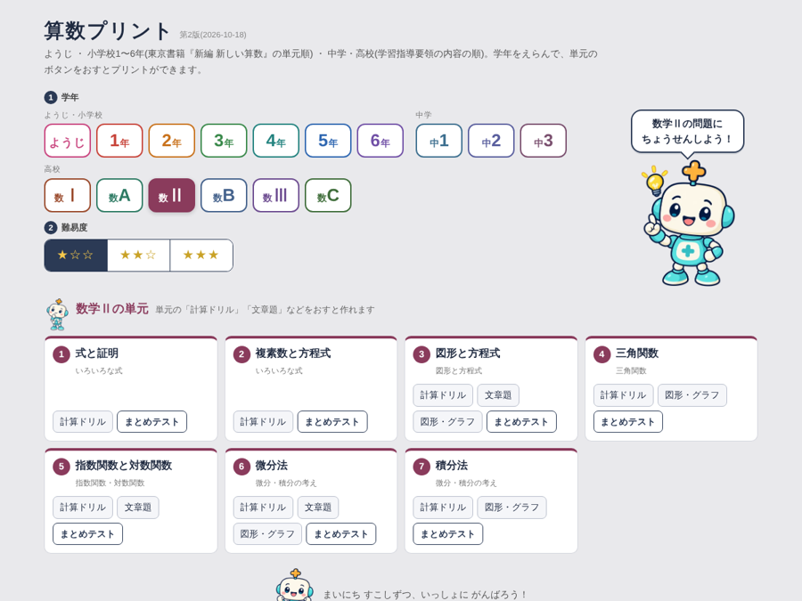
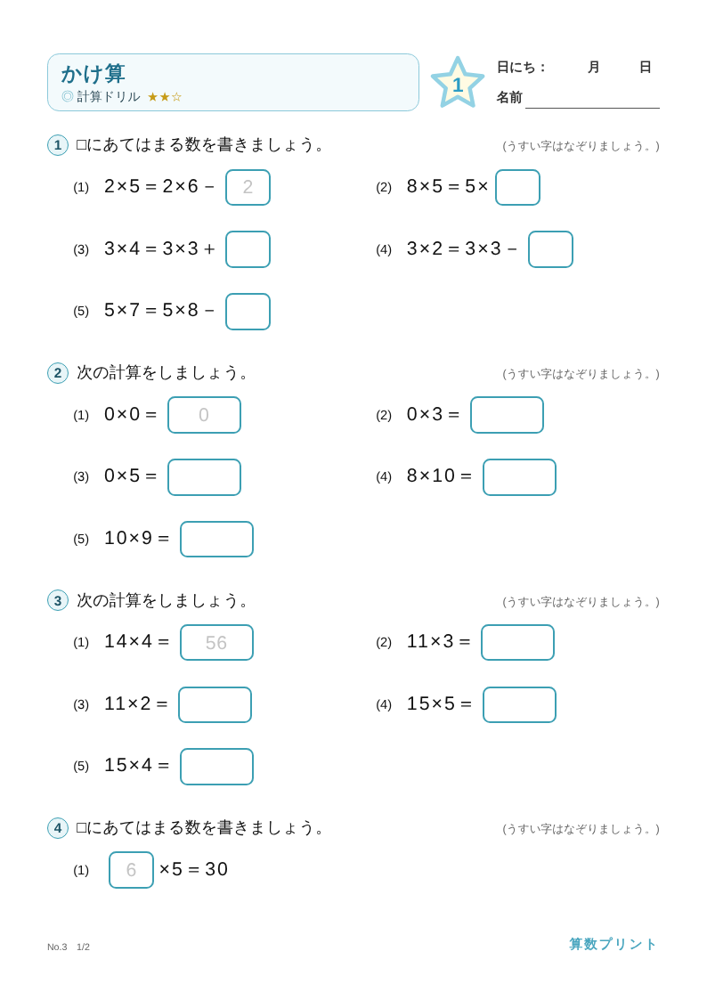
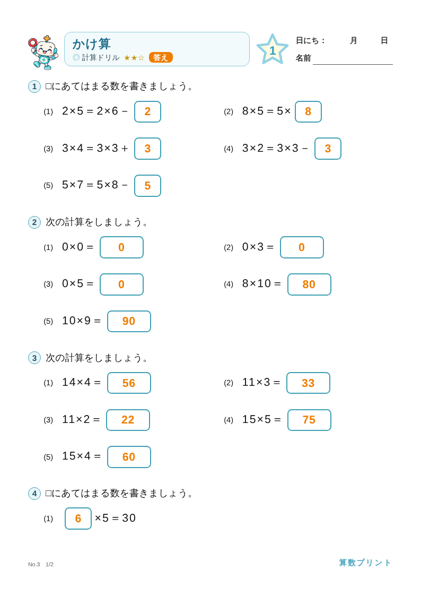
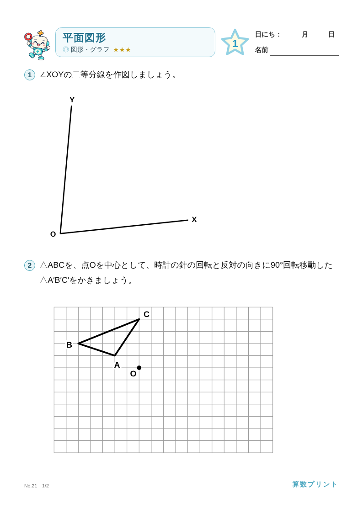
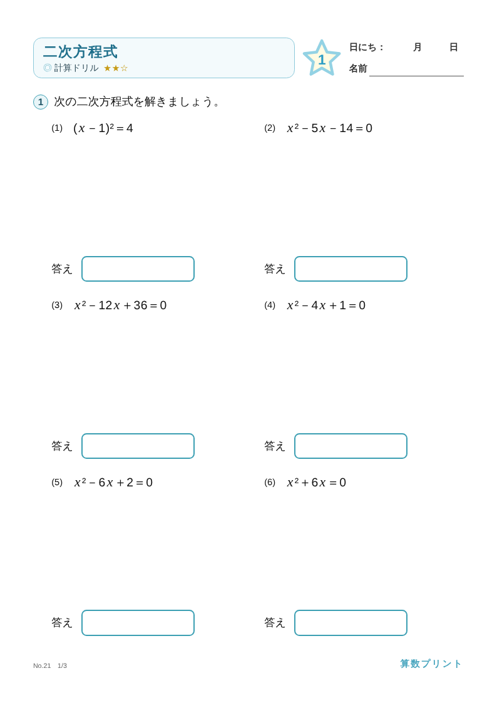
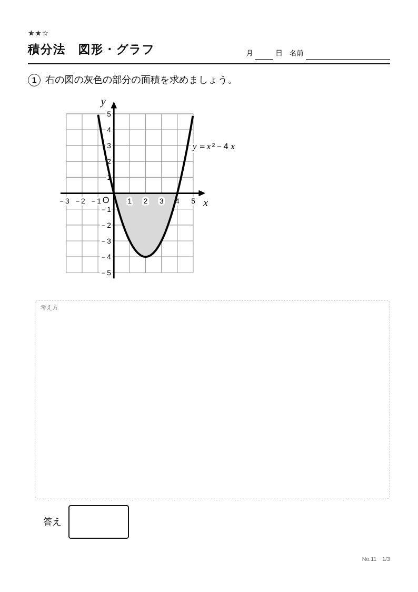
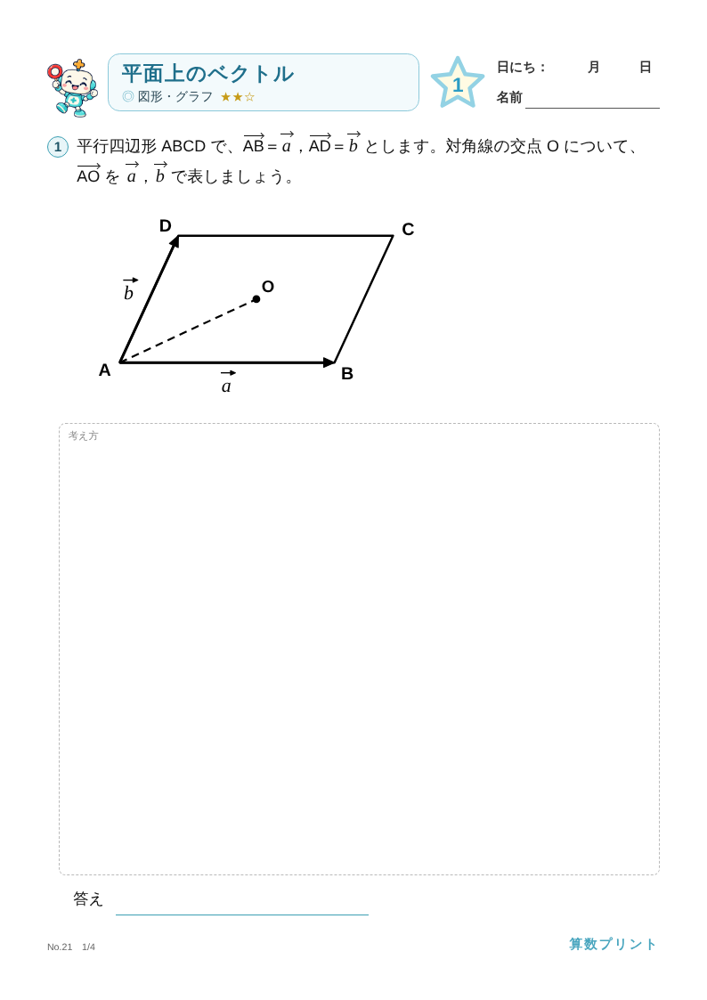

# 算数プリント

ようじ・小学校1〜6年・中学1〜3年・高校(数学Ⅰ・A・Ⅱ・B・Ⅲ・C)の算数・数学プリントを、ブラウザだけで作れるアプリです。
学年・単元・種類・難易度をえらぶと、そのたびに問題がかわるプリントと答えのページができます。
インターネットにつながっていなくても、`docs/index.html` を開くだけで動きます(1 ファイルで完結)。

**▶ アプリを開く:** https://iamochiai-collab.github.io/Math-worksheet-generator/



| 3年 かけ算(お手本のうすい字つき) | 答えのページ(問題のプリントにオレンジの字で書きこむ) |
|---|---|
|  |  |

| 中1 図形の移動 | 中3 二次方程式 |
|---|---|
|  |  |

| 数学Ⅱ 面積(図) | 数学C 図形とベクトル |
|---|---|
|  |  |

## できること

- **学年**:ようじ(3〜6さい)、小学校1〜6年(東京書籍『新編 新しい算数』の単元順)、中学1〜3年、高校の数学Ⅰ・数学A・数学Ⅱ・数学B・数学Ⅲ・数学C(中学・高校は学習指導要領の内容の順)
- **特別支援学校の段階**:メニューのバナー「特別支援学校 各段階のプリントは こちら！」から、知的障害の特別支援学校の学習指導要領(算数・数学)の段階(小学部1〜3段階・中学部1・2段階・高等部1・2段階)と内容(A〜D)に合わせたプリントを作れます。問題は少なめ・字は大きめ。小学部1・2段階は絵のプリント(ある・ない、おなじものをむすぶ、なかまあつめ、おおきい・ちいさい など)。お金(いくらかな・ぜんぶで いくら・ちょうど はらう・おつり)も段階ごとに入っています
- **くらしの数学(高等部)**:特別支援のメニューの「高等部」にある「くらし」から、くらしや働く場面の問題(23単元)を作れます。健康・身体計測・サイズ・スポーツテスト、天気予報・気温・買い物(レシート・ポイント・分割払い)・調理(レシピの分量・割引・食品表示ラベル)・カレンダー、時計と時間の計算・待ち合わせ(時刻表・運賃)・ICカードのチャージ・財布のお金で払う・割り勘・広告・収納、小遣いの使い方・支出の項目・小遣い帳・宅配便・契約アンペア・家賃と初期費用、通勤(乗りかえ)・作業速度・勤務時間・求人票・年次有給休暇・給与明細。数や場面は毎回かわり、答えのページもつきます
- **小単元**:小学校は、単元の中の小単元(例:「折れ線グラフと表」の「2本の折れ線グラフ」)だけのプリントも作れます。見出しは「折れ線グラフと表 8」「◎ 2本の折れ線グラフ」のようになります
- **種類**:計算ドリル・文章題・図形/グラフ・単元まとめテスト(ようじは絵のプリント)
- **難易度**:★☆☆・★★☆・★★★
- **答え**:答えのページつき。問題のプリントと同じページに答えをオレンジの字で書きこんだ形(1ページずつ対応)か、答えだけの一覧をえらべます。シード番号が同じなら、同じプリントをもう一度作れます
- **見出し**:単元名・星の中のページ番号・日にちと名前のらん。まとめて作るときは、星の番号が通し番号になります
- **お手本**:「お手本(うすい字)をつける」で、それぞれの大問の(1)に答えをうすい字で入れます(なぞり書き用)
- **漢字**:「習っていない漢字は使わない」「ふりがなをつける」「ヒントをつける」を切りかえられます
- **まとめて作る**:問題のページ数(1〜100ページ)を指定して、まとめて印刷、または PDF・JPG(zip)で保存できます。指定したページ数ちょうどになるように、最後のプリントは途中で区切ります(答えはそのぶんだけ)

## 使い方

1. `docs/index.html` をダウンロードして、Edge か Chrome で開きます。
2. メニューで学年と難易度をえらび、単元の「計算ドリル」などのボタンをおします。
3. 「印刷」で印刷します。「まとめて作る・保存」で、まとめて印刷・PDF・JPG にできます。

スマホでも、上の「アプリを開く」のリンクから開けます(プリントは画面のはばに縮めて表示します。印刷・PDF はA4のままです)。

iPad では、「ファイル」アプリで `index.html` を長押し →「共有」→「Microsoft Edge」で開いてください。

### GitHub Pages で公開する

このリポジトリを GitHub にあげたあと、
**Settings → Pages → Build and deployment** で
「Source: Deploy from a branch」「Branch: `main`」「フォルダ: `/docs`」をえらんで保存します。
しばらくすると `https://<ユーザー名>.github.io/<リポジトリ名>/` で開けるようになります。

## フォルダの構成

```
.
├─ docs/
│  ├─ index.html          ← できあがったアプリ(これだけで動く。GitHub Pages の公開先)
│  └─ screenshots/        ← README 用の画像
├─ src/
│  ├─ template.html       ← アプリの本体(画面・プリントの組み立て・小学校の問題など)
│  └─ generators/         ← あとから足した問題をつくる部品
│     ├─ yoji/            ← ようじ
│     ├─ tokushi/         ← 特別支援学校の段階(段階ごとの単元のならび・小学部1段階の絵のプリント・part2〜6 は高等部の「くらしの数学」)
│     ├─ g3MergeTables/   ← 3年「ぼうグラフと表」の「1つの表にまとめよう」(+ topics.json)
│     ├─ g4LineGraph/     ← 4年「折れ線グラフと表」(+ topics.json)
│     ├─ chu1/            ← 中学1年
│     ├─ chu2/            ← 中学2年
│     ├─ chu3/            ← 中学3年
│     ├─ kou0/            ← 高校の共通の道具(式の検算・グラフ・記号)
│     ├─ kou1/ kouA/      ← 数学Ⅰ・数学A
│     ├─ kou2/ kouB/      ← 数学Ⅱ・数学B
│     └─ kou3/ kouC/      ← 数学Ⅲ・数学C
├─ assets/chara/          ← メニューのキャラクター画像(webp)
├─ assets/money/          ← お金(こうか・おさつ)の絵(webp)
├─ assets/icon/           ← サイトのアイコン(ブラウザのタブ・ホーム画面)
├─ assets/money/          ← お金(こうか)の絵(webp)
├─ vendor/                ← PDF・JPG・zip 用の道具(html2canvas / jsPDF / JSZip)とライセンス
├─ tools/
│  ├─ build.py            ← 1 ファイルにまとめる
│  └─ test/               ← 検査(Playwright)
└─ .github/workflows/check.yml ← push したときの自動検査
```

`docs/index.html` は `tools/build.py` で作るファイルです。直接は書きかえず、`src/` などを直してから作り直してください。

## 作り直し方

Python 3 があれば作れます(追加のパッケージはいりません)。

```sh
python3 tools/build.py
```

- `docs/index.html`(公開用)と `build/test.html`(検査用。git には入れない)ができます。
- `src/template.html` の `{{CHARA:名前}}` に `assets/chara/名前.webp` が、`{{VENDOR:ファイル名}}` に `vendor/` のファイルが入ります。
- `src/generators/<名前>/*.js` は、フォルダ名の順・ファイル名の順につないで入れます。

## 検査

Node.js 20 以上と Playwright を使います。

```sh
npm install
npx playwright install chromium
npm test                 # 問題の検査(答えが合うか・重複しないか・ふりがなのない漢字がないか)
npm run test:layout      # 全部の組み合わせでプリントを作り、はみ出し・番号のずれがないか(時間がかかります)
npm run test:clip        # 図の中の文字のはみ出し(参考)
npm run test:sub         # 小学校の小単元ごとのプリントのはみ出し・番号のずれ(時間がかかります)
npm run test:kurashi     # くらしの数学:ふりがなのない漢字・いちばん多い問題数で作れるか
```

1つの単元だけ調べるときは、たとえば次のようにします。

```sh
node tools/test/generators.js build/test.html c3-03 200
node tools/test/render.js build/test.html c3-03 drill normal 20 5 out/c3-03-   # 画像にして見る
```

## 問題の部品を足すとき

`src/generators/<名前>/` に JavaScript を置きます。中学の部品は次の形です(例:`chu1/part1.js`)。

```js
var chu1 = (() => {
  const gen = {
    id: "c1.addSub",                         // 部品の名前
    instruction: "次の計算をしましょう。",     // 大問の指示(文章題は null)
    defaults: { ... },
    levels: { basic: { ... }, normal: { ... }, challenge: { ... } },
    generate(rng, p, ctx) { return { key, text, answer: { display }, workspace: { type: "none" }, meta }; },
    verify(pr, p) { return null; }            // 答えが正しければ null、まちがいならその理由
  };
  return [gen];
})();
var chu1Grade = { grade: 7, units: [ ... ] };  // 学年と単元(src/template.html の GRADES に入る)
```

- 漢字は `{漢字|かんじ}` の形で書くと、ふりがなをつけられます(中学は `R()` で辞書から自動でつけています)。
- 文字は `[[v:x]]`、分数は `[[f:2/3]]`、根号は `√{3}`、連立方程式は `[[sys:式1||式2:sys]]` と書きます。
- 高校では、添字 `[[_n]]`、指数 `[[^n]]`、ベクトル `[[vec:a]]`、共役(上線) `[[bar:z]]`、積分 `[[int:0:1]]`、Σ `[[sum:k＝1:n]]`、極限 `[[lim:n→∞]]`、循環小数の点 `[[dot:3]]` も使えます。式の中の英字は `kouLib.X()` でまとめて斜体にできます。
- 高校の部品は `kouLib.gen()` で作り、答えは `kouLib.evalH()`(小数で式の値を計算する)などで検算します。
- 新しい部品を足したら `npm test` で検査してください。

## 著作権・ライセンス

算数プリントの著作権は、落合聡一にあります(© 2026 落合聡一)。

- プログラムと問題の部品は [MIT ライセンス](LICENSE) です。だれでも自由に使う・コピーする・書きかえる・配ることができます(著作権表示と LICENSE の文はのこしてください)。
- `assets/chara/` のキャラクター画像は MIT ライセンスにふくまれません。著作権は落合聡一にあり、許可なく使うことはできません。
- `assets/money/` のお金(こうか・おさつ)の絵は MIT ライセンスにふくまれません。使うときは、もとの絵の利用条件にしたがってください。
- `assets/money/` のお金(こうか)の絵は MIT ライセンスにふくまれません。使うときは、もとの絵の利用条件にしたがってください。
- `vendor/` の html2canvas(MIT)・jsPDF(MIT)・JSZip(MIT または GPLv3)は落合聡一の作ったものではないため、それぞれの作者のライセンスにしたがいます(`vendor/licenses/`)。
